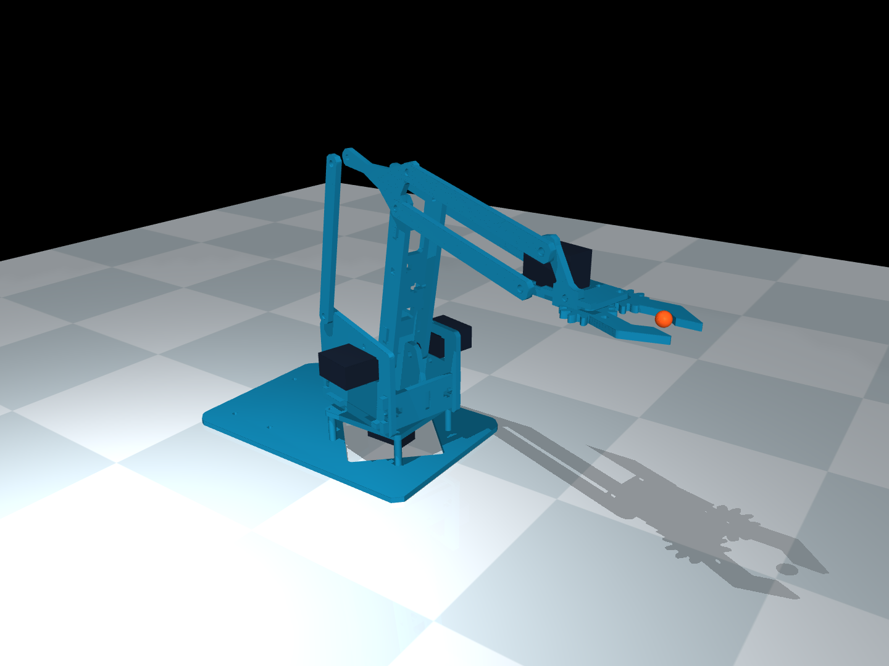
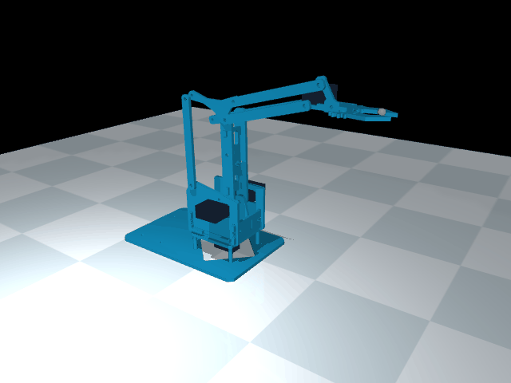

# MeArm Classic V1 simulation models

An assembled, articulated MeArm for **MuJoCo**, **Gazebo Sim**, and ROS visualization.
Four independent controls operate base yaw, shoulder elevation, forearm elevation,
and the gripper. Passive constraints reproduce the ideal parallelogram behavior
that keeps the hand level.



The assembly uses the mesh placements from
[kubasikora/mearm_model](https://github.com/kubasikora/mearm_model), retargeted to
the official [Arduino V1 geometry](https://github.com/MeArm/MeArm-Arduino/blob/master/config.h).
The original ROS model is included under `references/community/`. Its missing
inertias, contradictory mimic limits and unsuitable mesh collisions are replaced
in the generated models. Separate CAD exports extrude the official V1.1 DXF
contours at 3 mm thickness.

## Simulation results

### Joint motion in MuJoCo



A six-second physics-driven demonstration of the four servo controls and the
passive linkage that keeps the gripper level.

### Pick and place with colored cubes


The arm grasps a **20 × 20 × 20 mm red cube**, lifts it, transfers it to the
marked destination, releases it, and retreats. The cube is carried through
simulated gripper contact and friction. This clip is sped up.
See the [pick-and-place guide](docs/pick_and_place.md) and
[recorded simulation results](docs/pick_place_validation.json).

## Run MuJoCo

Python 3.10+ is recommended. From this directory:

```sh
python -m pip install -r requirements.txt
python scripts/run_mujoco.py --demo
```

The viewer provides camera controls and four actuator sliders. Without `--demo`,
expand **Control** in the right panel to move the arm directly. Shift+Tab shows
or hides that panel. Native sliders use radians. For live commands in degrees
and tool targets in millimeters:

```sh
python scripts/run_mujoco.py --interactive
```

Then type `joints 20 65 -20 15`, `xyz 120 30 120`, or `home` in the terminal.
See the [control guide](docs/mujoco_control.md) for the angle conventions, XYZ
workspace, and an editable Python movement example.

```sh
python scripts/run_mujoco.py
python scripts/run_mujoco.py --headless --demo --seconds 10
python scripts/run_mujoco.py --render docs/preview.png
python scripts/run_mujoco.py --gif docs/motion.gif
```

On Windows, `py` may replace `python`. On macOS, interactive MuJoCo viewers may
require `mjpython scripts/run_mujoco.py`. The prebuilt XML and STL files work
without rebuilding. Active Conda and virtual environments use their own installed
packages. Outside those environments, compatible project-local `.deps/` wheels
are an optional fallback; Python 3.12 wheels are never injected into Python 3.10.
On this Windows workspace, the installed local runtime and dependencies can
also be used with `./start_mujoco.ps1 -Demo` from PowerShell.
If PowerShell blocks scripts, use
`powershell.exe -NoProfile -ExecutionPolicy Bypass -File ./start_mujoco.ps1 -Demo`.
This override applies only to that process. The launcher respects an active Conda
or virtual environment. Direct Python invocation avoids the PowerShell launcher:

```sh
conda activate mearm
python -m pip install -r requirements.txt
python scripts/run_mujoco.py --demo
```

## Arm with colored cubes

The separate scene contains four physical **20 × 20 × 20 mm** cubes and supports
manual joint control and automatic tool positioning:

```sh
python scripts/run_cube_scene.py --mode manual
python scripts/run_cube_scene.py --mode auto --target-mm 160 0 120
python scripts/run_cube_scene.py --mode auto --cube red
python scripts/run_cube_scene.py --mode auto --cube red --target-mm 180 -45 90
```

Targets use world millimeters. Cubes sit on an 80 mm platform within the arm's
workspace. See the [cube scene guide](docs/cube_scene.md) for live mode switching,
cube placement, rendering and the two control modes.
To pick and place, combine a cube color with its destination center in world
millimeters; on the supplied tabletop use Z=90 mm. See the
[pick-and-place guide](docs/pick_and_place.md) for the sequence and contact model.

## Synchronize with a real Arduino MeArm

The USB bridge supports **MuJoCo targets driving four real servos** and
**Arduino local-controller commands driving MuJoCo**. It uses measured per-joint
pulse calibration, explicit arming, independent firmware speed limits and a
connection watchdog. Standard three-wire servos provide command telemetry;
actual joint angles require additional sensors.

Start without hardware:

```sh
python -m pip install -r requirements-hardware.txt
python scripts/sync_arduino.py --dry-run
```

Follow the [complete Windows wiring, calibration and synchronization guide](docs/hardware_sync.md)
before enabling motors. It explains how to prepare your measured profile and
upload `arduino/MeArmSync/MeArmSync.ino`. After those steps:

```sh
python scripts/sync_arduino.py --port COM3 --calibration config/hardware_calibration.json
```

Replace `COM3` with your board's port. The connection starts disarmed; type
`arm` only after physically matching the supported arm to your calibrated HOME.
Then use the viewer sliders or terminal joint/XYZ commands. The supplied example
calibration deliberately cannot arm real hardware.

## Run Gazebo

Use **Gazebo Harmonic with Bullet Featherstone**. The default DART engine does
not implement the required native mimic constraints. From Ubuntu / WSL:

```sh
export GZ_SIM_RESOURCE_PATH="$PWD/models${GZ_SIM_RESOURCE_PATH:+:$GZ_SIM_RESOURCE_PATH}"
gz sim -r gazebo/world.sdf --physics-engine gz-physics-bullet-featherstone-plugin
```

In another terminal:

```sh
python scripts/gazebo_command.py --yaw 20 --shoulder 65 --forearm -20 --grip 15
```

See [Gazebo setup, controller topics and checks](docs/gazebo.md). The SDF has
structural checks; **a Gazebo runtime is not installed on this machine, so the
Gazebo physics run remains unverified**. MuJoCo is the locally exercised engine.

## Files and calibration

| File | Purpose |
| --- | --- |
| `mujoco/mearm.xml` | Self-contained MJCF, using the shared STL directory |
| `models/mearm_v1/model.sdf` | Gazebo robot with native passive-joint coupling |
| `gazebo/world.sdf` | Fixed-base demonstration world |
| `urdf/mearm.urdf` | SI URDF with valid inertias, collisions and mimic relations |
| `models/mearm_v1/meshes/` | Local, meter-scale assembled link meshes |
| `cad/cut_parts/` | Individual extruded official DXF plate contours |
| `cad/mearm_assembled.glb` | Colored static assembly for general 3D viewers |
| `cad/mearm_assembled.stl` | Static neutral assembly for CAD import; units meters |
| `cad/v1_cut_sheet.obj` | Full plate layout extruded to 3 mm |
| `docs/cut_parts.png` | Numbered contours corresponding to `cad/parts.json` |
| `config/mearm_v1.json` | Dimensions and estimated physical parameters |
| `config/model_spec.json` | Generated common model definition |
| `docs/validation.json` | Results from the local physics checks |

The model follows 80 mm upper arm, 80 mm forearm and 68 mm combined horizontal
offset from the official V1 Arduino configuration. The shoulder height and
offset use the supplied community assembly; the TCP convention is documented in
[kinematics and fidelity](docs/kinematics.md). Measure these on your particular
kit before using it for sim-to-real work.

Masses, collision shapes, servo torques, speeds, friction and jaw travel are
initial estimates. This is a reduced articulated model with ideal linkage
constraints. It does not model flex, backlash, individual screws, servo
electronics or the detailed gear-tooth contact of the gripper. Self-collision
is disabled for the overlapping linkage plates. Ground and external-object
contacts use explicit collision proxies. No grasp-success claim is made.

## Rebuild and validate

```sh
python scripts/inspect_dxf.py
python scripts/build_models.py
python tests/validate_model.py
python scripts/validate_gazebo.py
```

Source files are pinned and included; the build requires no network access.
See [source provenance and licenses](THIRD_PARTY.md). Keep those notices with
redistributed models; the community mesh license needs confirmation at its
original Thingiverse source before public redistribution.
