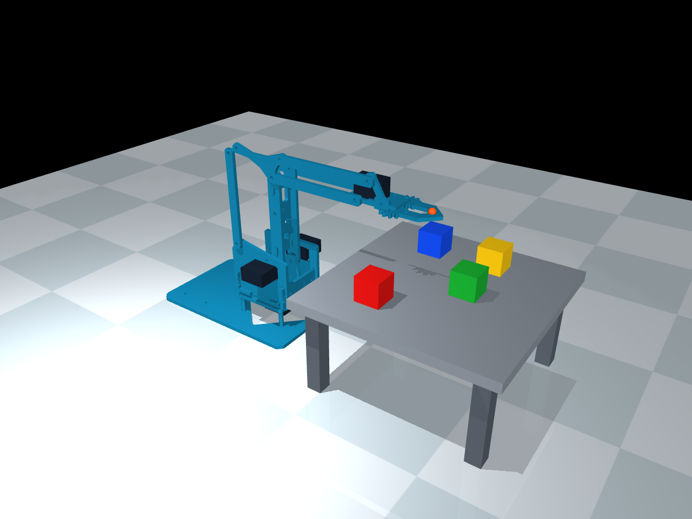

# MeArm scene with colored 2 cm cubes

The separate launcher is `scripts/run_cube_scene.py`. It uses the existing arm
and controller without changing `scripts/run_mujoco.py` or `mujoco/mearm.xml`.
Run from the project folder with your `mearm` Conda environment active.



## Mode 1: manual joint control

```bat
python scripts/run_cube_scene.py --mode manual
```

Expand **Control** in MuJoCo's right panel. The `base`, `shoulder`, `elbow` and
`gripper` sliders command the four independent joints. The passive linkage
joints remain constrained. Shift+Tab toggles the panel.

Native sliders use radians. For a starting pose in geometric degrees:

```bat
python scripts/run_cube_scene.py --mode manual --joints 20 65 -20 15
```

Order: yaw, upper-arm elevation, forearm elevation, jaw opening. Shoulder 90°
is vertical; forearm 0° is horizontal. The same angle conventions as the
[existing control guide](mujoco_control.md) apply. The grasp-ready cube scene
opens the jaws from 0 to 40.1°.

## Mode 2: automatic reaching

To **pick and place** a selected cube, provide both its color and a destination:

```bat
python scripts/run_cube_scene.py --mode auto --cube red --target-mm 180 -45 90
```

The destination is the **cube center**, in world millimeters. On the supplied
80 mm tabletop its center Z is 90 mm. The arm opens, approaches, grasps, lifts,
transfers, lowers, releases and retreats. See the [pick-and-place guide](pick_and_place.md)
for placement constraints, live commands and physical grasp details.

To reach a tool position without picking a cube, omit `--cube`:

```bat
python scripts/run_cube_scene.py --mode auto --target-mm 160 0 120
```

The target is the tool center point in **world millimeters**: X forward,
Y left, Z above the floor. The controller solves inverse kinematics, checks
joint limits, follows a smooth joint trajectory and then holds the target.
It reports arrival using the measured tool position, with a default 3 mm
tolerance. The magenta marker is the requested target and the orange marker
is the arm's tool point. Motion does not teleport the arm or reset the cubes.

Automatic mode owns the actuator commands, so slider changes are overwritten
while it is active. Use manual mode when operating the sliders.

Adjust motion duration and gripper opening:

```bat
python scripts/run_cube_scene.py --mode auto --target-mm 160 0 120 --move-seconds 3 --grip-deg 20
```

For a reach-only command, automatic mode starts with an open gripper at 28°.
Live reach-only mode switches preserve the current jaw command. Pick-and-place
controls jaw opening and closure automatically.
Joint-space interpolation checks endpoint joint limits; it does not plan a
collision-free path around objects. If a collision prevents arrival, the actual
tool error remains visible rather than being reported as success.

## Aim above a colored cube

```bat
python scripts/run_cube_scene.py --mode auto --cube red
python scripts/run_cube_scene.py --mode auto --cube blue --hover-mm 40
```

Colors: `red`, `green`, `blue`, `yellow`. `--cube` uses the selected cube's
current center plus a vertical offset; default 30 mm. Since a cube's top is 10 mm
above its center, the default target is 20 mm above its top face.
`--target-mm` alone specifies an exact tool position without an added offset.
Combined with `--cube`, it becomes the desired placed cube center instead.

## Switch modes or targets while the viewer stays open

```bat
python scripts/run_cube_scene.py --mode manual --interactive
```

Type in the launch terminal while MuJoCo remains open:

```text
joints 20 65 -20 15
auto 160 0 120
manual
yaw -20
cube red
pick red 180 -45 90
status
cubes
quit
```

`manual` releases the automatic controller, allowing joint commands and native
sliders. `auto X Y Z` enters automatic mode for a new target. `cube COLOR` enters
automatic mode above a cube, using `--hover-mm`. `status` shows the mode,
commanded angles and measured tool position; `cubes` prints their current
center coordinates. A rejected target leaves the current motion intact.

## Cube geometry and placement

Each cube has **20 × 20 × 20 mm** sides. MuJoCo box half-sizes are therefore
`0.01 0.01 0.01` meters. Cubes have free joints, gravity, contact and friction;
their positions can change when pushed. The estimated mass is 8 g per cube.

| Cube | Initial center X, Y, Z (mm) |
| --- | --- |
| Red | 130, −45, 90 |
| Green | 180, 0, 90 |
| Blue | 130, 45, 90 |
| Yellow | 180, 45, 90 |

The platform top is 80 mm above the floor, so cube centers start at 90 mm.
The elevation makes the cubes reachable with the current arm joint limits;
floor-level cube centers would be below that workspace. Edit `CUBES` and the
scene dimensions in `scripts/cube_scene.py` to change their arrangement.

The launcher builds this scene from the current arm model at runtime. A portable
copy is also provided as `mujoco/mearm_cubes.xml`. Regenerate that copy after
changing the arrangement:

```bat
python scripts/cube_scene.py
```

## Render or test without a viewer

```bat
python scripts/run_cube_scene.py --mode auto --target-mm 160 0 120 --headless --seconds 5
python scripts/run_cube_scene.py --mode manual --render docs/cube_scene.png
python scripts/run_cube_scene.py --mode auto --cube red --headless --report tmp/red_reach.json
python -m unittest discover -s tests -p test_cube_scene.py -v
```

`--report` saves the target, measured tool position, error, arrival status,
current cube centers and physics warnings. Pick-and-place reports also include
stage history, measured placement error and verified release status. These are measurements from the
simulation; the arm and cube physical parameters remain estimates.

The cube-scene launcher enables a grasp-ready gripper profile: visible compliant
rubber pads and jaw travel from 0 to 40.1°. The original arm-only model retains
its original geometry and limits. Scene grasps use contact and friction, with
no artificial attachment or cube pose reset. These parameters are simulation
estimates rather than measurements of the physical kit.
