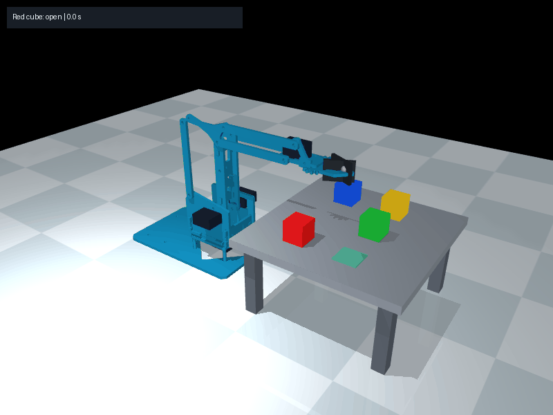

# Pick and place a cube by color



From the project directory, with your `mearm` environment active:

```bat
python scripts/run_cube_scene.py --mode auto --cube red --target-mm 180 -45 90
```

The arm selects the red cube at its current simulated position, opens the
jaws, approaches from above, closes the pads, lifts, carries, lowers onto the
table, opens, and retreats. The viewer stays open after completion.

Other colors: `green`, `blue`, `yellow`. An equivalent explicit destination flag:

```bat
python scripts/run_cube_scene.py --mode auto --cube blue --place-mm 180 -45 90
```

## Destination coordinates

With a selected cube, XYZ describes the **final cube center**, in world
millimeters: X forward, Y left, Z above the floor. The tabletop is 80 mm high
and the cube is 20 mm tall, so supported destinations use **Z=90 mm**.

The controller rejects destinations that are outside the table, occupied by
another cube, unsupported, or unreachable at any required waypoint. It leaves
the current controls unchanged when a request is rejected. The complete rotated
cube footprint must fit on the table, with at least 2 mm clearance from other
cubes. This version places on the existing tabletop; stacking and other support
surfaces are not planned.

`--cube` alone retains the previous hover behavior. `--target-mm` alone retains
the previous tool-reaching behavior. Supplying both requests pick-and-place.

## Grasp and motion

The cube remains a free physical body throughout the operation. Both finger
pads must touch it before lifting; contact and friction carry the load. The
controller does not teleport cubes or create temporary attachments.

The cube scene uses visible rubber pads, 40.1° maximum jaw opening, and a
17.19° holding command. During contact the actual jaw angle differs from the
holding command because the cube resists closure. The original arm-only model
is unchanged. Pad friction, softness and dimensions are tuned estimates for
this 20 mm cube exercise, not measured properties of the real hardware.

The tool point approaches 14 mm above the selected cube center. A default
35 mm lift clearance gives a transport tool height around 139 mm. The selected
cube is carried above the other cubes and lowered onto the table before release.
Each stage uses smooth joint interpolation, measured tool position and timeout
checks. A missed grasp, lost cube or blocked waypoint produces a failed result.

The default sequence takes about 21 simulated seconds. Successful completion
requires release followed by at least 0.5 seconds of settling, low cube velocity
and a measured cube-center error within 3 mm of the requested destination.
The green square marks the placement location; the magenta sphere shows the
current tool waypoint. The orange sphere is the measured tool point.

Change timing or lift clearance if needed:

```bat
python scripts/run_cube_scene.py --mode auto --cube red --target-mm 180 -45 90 --move-seconds 2.5 --clearance-mm 35
```

Larger clearance values can make waypoints unreachable; the controller checks
them before starting. Endpoint and table checks do not constitute a general
collision-avoidance planner for arbitrary objects or cube arrangements.

## Switch between manual and automatic operation

```bat
python scripts/run_cube_scene.py --mode manual --interactive
```

Type in the launch terminal:

```text
pick red 180 -45 90
status
cubes
```

Wait for `complete` before starting another operation. `cancel` or `manual`
stops the sequence and returns actuator control to the manual sliders. The
current jaw target remains in place so you can decide when to open the gripper.
Use `grip 40` in manual mode to open it. `quit` closes the viewer.

## Verify without a viewer

```bat
python scripts/run_cube_scene.py --mode auto --cube red --target-mm 180 -45 90 --headless --report tmp/pick_red.json
python -m unittest discover -s tests -p test_pick_place.py -v
```

Finite pick-and-place runs default to 30 simulated seconds. Use `--seconds`
when changing stage timing. The JSON report contains selected color, requested
cube center, measured final cube center, error, release status and stage history.
The overall `reached` field means verified pick-and-place completion for this
task, rather than tool arrival at an intermediate waypoint.

Implementation: `scripts/pick_place.py` contains the staged controller;
`scripts/cube_scene.py` supplies the grasp-ready physical scene; and
`scripts/run_cube_scene.py` handles launch options, manual controls and reporting.
