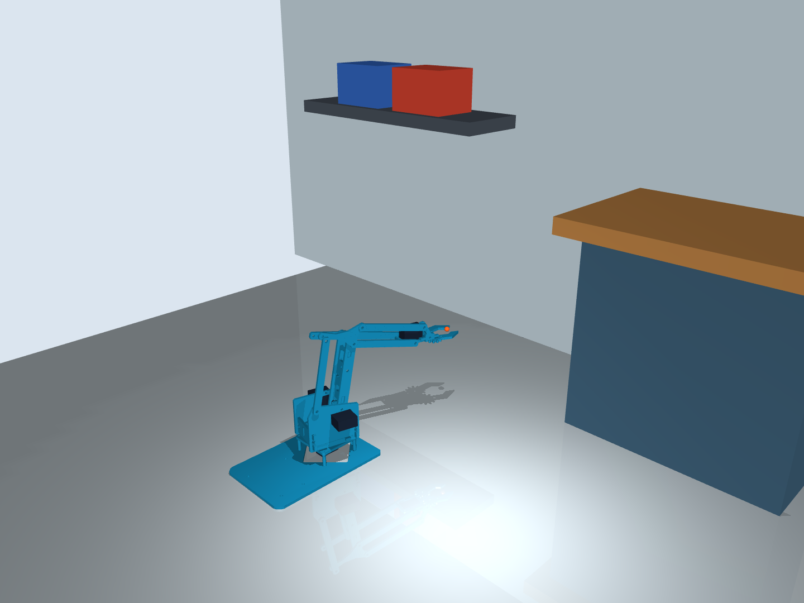

# Scene backgrounds in MuJoCo and Viser

Both launchers use the same MeArm model, MuJoCo physics, scene importer, joint
limits and coordinate system. Viser provides a browser viewer and controls;
MuJoCo computes its arm motion and passive linkage constraints.

Viser uses explicit ambient/key/fill lights and a studio environment map for
illumination only; that map is hidden from the background. Dynamic shadows are
disabled to avoid black surfaces and shadow-map stripes at the arm's small scale.
If an older Viser session appears black, stop its Python process with Ctrl+C,
restart the viewer, then hard-refresh the browser with Ctrl+F5.

The default is **empty**: the arm, a plain support floor, lights and a solid
background. Furniture, images and cubes appear only when requested. The Gazebo
world also starts with just the arm, ground and lighting; the importer described
here targets MuJoCo and Viser.



## Windows environment

Create a project-local `.venv` and install its dependencies using the
[fresh Windows installation guide](../install.md). The environment directory is
not included in a source checkout or model bundle. No PowerShell activation or
execution-policy change is required for the direct commands below:

```powershell
cd "$env:USERPROFILE\Documents\MeArm"
.\.venv\Scripts\python.exe scripts/run_mujoco.py
.\.venv\Scripts\python.exe scripts/run_viser.py
```

For a new installation, create an environment and install the dependencies:

```powershell
python -m venv .venv
.\.venv\Scripts\python.exe -m pip install -r requirements-viser.txt
```

Alternatively, install `requirements-viser.txt` in your existing Conda environment
and replace `.\.venv\Scripts\python.exe` with `python` below.

Viser prints its local URL, normally **http://127.0.0.1:8080**. Open it in your
browser; Ctrl+C in the terminal stops the server. The default bind address is
local-only. If port 8080 is busy, Viser chooses the next available port and prints
the actual address. You can also choose `--port 8081` explicitly.

## Select a scene

Use the same `--scene` value in either viewer:

```powershell
.\.venv\Scripts\python.exe scripts/run_mujoco.py --scene workshop
.\.venv\Scripts\python.exe scripts/run_viser.py --scene workshop
```

| Scene value | Result |
| --- | --- |
| `empty` or no option | Plain default environment |
| `workshop` | Small workshop backdrop with cabinet and shelf |
| `classroom` | Classroom-style wall, board and desk |
| `demo_classroom` | Reconstructed table, Rubik's cube, bottle and can, with native collisions |
| `scenes/demo_classroom/scene.xml` | Same reconstructed scene loaded directly as MJCF |
| `scenes/imported_room.json` | Included GLB room-import example |
| `C:/assets/room.glb` | Your own 3D scene |
| `C:/assets/background.jpg` | Your own image on an upright backdrop |
| `C:/assets/my_scene.json` | Your own layout of meshes, images and primitives |

The supplied rooms are compact example layouts, not measured replicas of a
physical room. All scene dimensions and positions use **metres**, with **Z up**,
**X forward**, **Y left**. The MeArm base stays at the origin.

In Viser, use **Environment → Preset**, or enter a server-local file path and
click **Load scene**. A failed import leaves the current scene active and shows
an error in Status. Successful scene changes reset simulated physics while
preserving joint targets. MuJoCo's native viewer loads the selected scene at
launch; restart it to select another one. Both viewers support camera orbit,
pan and zoom.

## Reconstructed demo classroom

`scenes/demo_classroom/` is a self-contained copy of the MuJoCo export from
AOE's `image_environments/t02_frame_smoke/`. Existing scene files and assets are
kept alongside it. The preset name is `demo_classroom`; it describes the saved
four-object reconstruction rather than a complete scanned classroom.

From the project directory, use a Python environment with `requirements-viser.txt`
and MuJoCo 3.10 or newer:

```bash
python scripts/run_viser.py --scene demo_classroom --no-robot
```

On the current Linux machine, the existing environment can be used directly:

```bash
/home/mihawk/anaconda3/envs/aoe_v1/bin/python /data/MeArm/scripts/run_viser.py --scene demo_classroom --no-robot
```

Open the printed local URL. The preset is also selectable under **Environment →
Preset**. Scene-only mode has playback/reset and scene selection without arm
controls. Omit `--no-robot` to include MeArm; it stays at the origin. The scene
keeps its measured scale and saved poses around X=2.2 m, so this does not place
the reconstructed objects within the small arm's reach. The camera frames visible
geometry automatically at launch, on scene changes and for new clients.

The copied objects remain static. Their four base-color textures and 49 convex
collision parts are retained, along with the source ground plane. Colliders are
hidden in Viser. A native MJCF import retains authored joints and collision
settings; when combined with MeArm, object names are prefixed `environment_`
and MeArm's physics options remain authoritative. In scene-only mode the source
physics options and object names are retained. `--scene-pos` and `--scene-rpy`
apply one rigid transform to the scene; native MJCF requires `--scene-scale 1`.

Custom native MJCF can be selected directly with `--scene /path/to/scene.xml`,
or referenced by a JSON preset:

```json
{
  "version": 1,
  "name": "My reconstructed scene",
  "mjcf": "relative/path/to/scene.xml",
  "objects": []
}
```

Keep each MJCF and its referenced asset folders together. The older mesh/image
import path below remains visual-only; the native MJCF path preserves collisions.

## Import a 3D room or background

Supported triangle-mesh formats are **GLB, GLTF, OBJ, STL and PLY**. GLB is a
convenient portable format because textures can be embedded in the file. Keep
OBJ/MTL image files and GLTF companion files together when using those formats.
Point-cloud-only PLY files are not supported.

```powershell
.\.venv\Scripts\python.exe scripts/run_mujoco.py --scene "C:/assets/my room.glb"
.\.venv\Scripts\python.exe scripts/run_viser.py --scene "C:/assets/my room.glb"
```

The importer retains scene-node transforms and repeated instances. For assets
exported in millimetres, apply a unit conversion. Use position and rotation to
align the background with the fixed arm base:

```powershell
.\.venv\Scripts\python.exe scripts/run_mujoco.py --scene "C:/assets/room.obj" --scene-scale 0.001 --scene-pos 0.2 0 0 --scene-rpy 90 0 0
.\.venv\Scripts\python.exe scripts/run_viser.py --scene "C:/assets/room.obj" --scene-scale 0.001 --scene-pos 0.2 0 0 --scene-rpy 90 0 0
```

`--scene-pos` is in metres. `--scene-rpy` is roll, pitch, yaw in degrees, applied
as fixed-axis X, Y, Z rotations. The example 90° roll is appropriate only when
your source axes need that conversion; it is not an automatic GLTF correction.
The order is scale, rotate, then translate. These options transform background
objects, not the arm or the default ground plane.

Imported geometry is **static and visual-only**. A concave room must not become
one convex collision hull, which could incorrectly block the arm inside an
apparently empty room. Add explicit box/sphere/cylinder collision proxies in a
JSON scene when physical obstacles are needed. No collision checking or path
planning is implied by displaying an imported background.

Base-color textures and material colors are supported. Renderers use different
lighting, so their images can differ. MuJoCo uses an average color for a mesh
with per-face/per-vertex colors; split such meshes into material groups or bake
a color texture for greater visual fidelity. Advanced PBR, normal maps,
animations, CAD assemblies and USD scenes are not imported by this mesh loader.
For MJCF, use the native import path described above. Use modest mesh sizes for
responsive loading and interaction.

## Import an image backdrop

PNG and JPEG images can be selected directly:

```powershell
.\.venv\Scripts\python.exe scripts/run_mujoco.py --scene "C:/assets/lab.jpg"
.\.venv\Scripts\python.exe scripts/run_viser.py --scene "C:/assets/lab.jpg"
```

An image becomes a textured rectangle behind the arm. Its default width is
1 metre, with height chosen from the image aspect ratio. It is placed at
`[0.35, 0, 0.25]` metres, facing the arm. This is a **flat world-space backdrop**,
not a 360° panorama or a screen-fixed overlay: orbiting the camera can reveal
its edges. Use a JSON layout to choose another size, orientation or location.

## Define your own layout

Copy `scenes/imported_room.json`, or create a file such as `scenes/my_lab.json`:

```json
{
  "version": 1,
  "name": "My lab",
  "background_rgb": [0.92, 0.94, 0.96],
  "floor_rgba": [0.88, 0.90, 0.92, 1],
  "objects": [
    {
      "name": "room",
      "type": "mesh",
      "file": "assets/my_room.glb",
      "scale": 1,
      "pos_m": [0, 0, 0],
      "rpy_deg": [0, 0, 0]
    },
    {
      "name": "obstacle",
      "type": "box",
      "size_m": [0.04, 0.04, 0.06],
      "pos_m": [0.20, -0.07, 0.03],
      "rgba": [0.8, 0.3, 0.2, 1],
      "collidable": true
    }
  ]
}
```

Paths in a JSON layout are relative to that JSON file. Direct command-line paths
are relative to your terminal's current directory. Quote paths containing spaces.
Each object needs a unique name containing letters, numbers, underscores or
hyphens.

| Object type | Required fields | Optional fields |
| --- | --- | --- |
| `mesh` | `file` | `scale`, `pos_m`, `rpy_deg`, `rgba` |
| `image` | `file` | `width_m`, `height_m`, `pos_m`, `rpy_deg`, `scale`, `rgba` |
| `box` | `size_m` (full X/Y/Z dimensions) | `pos_m`, `rpy_deg`, `scale`, `rgba`, `collidable` |
| `sphere` | `radius_m` | `pos_m`, `scale`, `rgba`, `collidable` |
| `cylinder` | `radius_m`, `height_m` (full height, local Z axis) | `pos_m`, `rpy_deg`, `scale`, `rgba`, `collidable` |

`scale` may be a positive number or three positive X/Y/Z factors in JSON.
Spheres need uniform scale; cylinder X/Y factors must match. Rotated primitives
cannot use combinations of non-uniform scale that create shear. Colors are
RGB/RGBA components between 0 and 1. An explicit `rgba` on an imported mesh
replaces its texture/color appearance. Collision defaults to `false` for all
added objects; mesh/image collision cannot be enabled directly.

To place an image explicitly, it starts in local XY and faces local +Z. For an
upright backdrop facing negative X, for example:

```json
{
  "name": "photo",
  "type": "image",
  "file": "assets/lab.jpg",
  "width_m": 0.9,
  "height_m": 0.5,
  "pos_m": [0.35, 0, 0.25],
  "rpy_deg": [90, 0, -90]
}
```

## Arm controls and optional cubes

MuJoCo retains native actuator sliders; `--interactive` also provides terminal
commands such as `joints 20 65 -20 15` and `xyz 120 30 120`. Its native shoulder
slider is an offset from vertical in radians, while terminal/Viser controls use
absolute elevation in degrees.

Viser has sliders for yaw, shoulder, forearm and jaw opening; **Reach target**
solves IK for an XYZ target in millimetres. Manual joint/XYZ commands stop the
joint demo. **Pause physics**, **Home**, and **Reset physics** are also available.
All joint changes pass through the same `MeArmController` limits. Joint/XYZ
targets are not collision-aware motion plans.

Cubes remain an explicit task choice, separate from the background:

```powershell
.\.venv\Scripts\python.exe scripts/run_viser.py --task cubes --scene workshop
.\.venv\Scripts\python.exe scripts/run_cube_scene.py --scene workshop --mode manual
.\.venv\Scripts\python.exe scripts/run_cube_scene.py --scene workshop --mode auto --cube red --place-mm 180 -45 90
```

In the Viser **Pick and place** folder, choose the cube color, set **Place X/Y/Z**
in millimetres, and click **Pick and place selected cube**. The default destination
is `[180, -45, 90]`. Place XYZ describes the **cube center**, so use Z=90 on the
80 mm tabletop. All four cubes measure 20 × 20 × 20 mm.

The browser shows the current phase and cube centers, and a green square marks
the destination. The arm opens, approaches, descends, grasps, lifts, transfers,
lowers, releases and retreats using the same contact/friction controller as the
MuJoCo cube runner. Both pad contacts are checked before lifting; completion
requires the released cube to settle within 3 mm of the destination. The cube is
not attached to the gripper or moved by directly changing its pose.

**Move duration** and **Lift clearance** adjust the staged motion. Manual
controls and scene changes are locked while a pick runs. **Pause physics**
freezes the current sequence; **Cancel pick and place** restores joint control
at the current commanded pose. **Reset physics** cancels the task and restores
the original cube positions. After completion, manual joint/XYZ controls are
available again. Use an unoccupied destination within the tabletop; invalid or
unreachable destinations are rejected before movement.

To start a job from the command line:

```powershell
.\.venv\Scripts\python.exe scripts/run_viser.py --task cubes --cube red --place-mm 180 -45 90
.\.venv\Scripts\python.exe scripts/run_viser.py --task cubes --scene classroom --cube blue --place-mm 180 -45 90
```

`--cube` and `--place-mm` must be supplied together and require `--task cubes`.
Optional `--move-seconds 2` and `--clearance-mm 35` set the initial job parameters.
Without those job flags the viewer starts in manual mode. Without `--task cubes`
it still defaults to an arm-only empty environment.

All four colors were exercised through actual Viser WebSocket button events;
see [Viser pick-and-place validation](viser_pick_place_validation.json).
The Arduino synchronization runner continues to use an empty background by
default; these scene viewers do not connect to hardware.

## Checks and references

```powershell
.\.venv\Scripts\python.exe -m unittest discover -s tests -p "test_*.py"
.\.venv\Scripts\python.exe tests/validate_viser.py
.\.venv\Scripts\python.exe scripts/run_mujoco.py --scene workshop --headless --demo --seconds 2
```

The Viser validation script uses real local HTTP/WebSocket connections to check
joint controls, IK, scene switching, failed-load recovery and textured imports.
Results are in [scene_validation.json](scene_validation.json). It does not verify
browser raster output. Browser automation was stopped by URL verification during
setup, so visual checking of Viser in your browser remains a manual step.
MuJoCo scene renders and the compiled-mesh pose mapping were checked separately.

The imported example room is original procedural geometry and can be regenerated
with `python scripts/create_scene_examples.py`. Keep the original licensing and
attribution for any third-party scene assets you import.

API references: [Viser scene API](https://viser.studio/main/api/core/scene_api/),
[Viser GUI API](https://viser.studio/main/api/core/gui_api/), and
[MuJoCo mesh and texture reference](https://mujoco.readthedocs.io/en/stable/XMLreference.html#asset-mesh).
